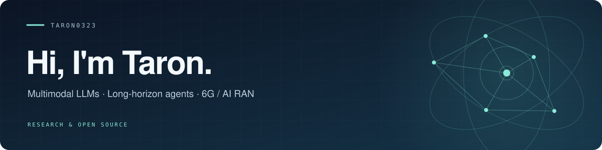

  

  <a href="mailto:futaoran2003@gmail.com">Email</a>
  &nbsp;·&nbsp;
  <a href="#publications">Publications</a>
  &nbsp;·&nbsp;
  <a href="#research-interests">Research interests</a>
  &nbsp;·&nbsp;
  <a href="#selected-projects">Selected projects</a>
  &nbsp;·&nbsp;
  <a href="https://github.com/Taron0323?tab=repositories">All repositories</a>

## Hello everyone 👋

🔭 My research interests include **multimodal learning and reasoning**, **long-horizon LLM agents**, and **video generation with physical consistency**.

📫 You can reach me at **[futaoran2003@gmail.com](mailto:futaoran2003@gmail.com)**.

## Publications

**[MUR: Multimodal Unified Refinement for Multimedia Recommendation](https://doi.org/10.1007/978-981-96-6588-4_27)** 
**Taoran Fu**, Jiaxuan Cao, Ziqian Wang, Min Yang 
**ICONIP 2024** · LNCS 15290, pp. 387-401 (2025).

Multimodal recommendation with contrastive learning, modality denoising, and dual-view fusion.

## Research interests

- **Multimodal recommendation:** contrastive learning, graph representation learning, feature denoising, and multimodal fusion.
- **LLM agents and planning:** long-horizon decision-making, future-action prediction, and plan consistency.
- **Multimodal RAG:** uncertainty estimation, adaptive retrieval, and attention-based evidence use across text, images, tables, and video.
- **Video generation and world models:** video tokenization, temporal representations, adaptive temporal sampling, and physical consistency.

## Selected projects

🛠️ I also build **open-source skills and workflows for mathematical modeling**, with tools for model design, validation, and research writing.

<table>
  <tr>
    <td width="50%" valign="top">
      <h3><a href="https://github.com/Taron0323/Huawei-Cup-Mathematical-Modeling-Skill">Huawei Cup Modeling Skill</a></h3>
      
A Codex skill for mathematical modeling, validation, paper revision, and Huawei Cup presentation preparation.

      
CODEX SKILL · MATHEMATICAL MODELING

    </td>
    <td width="50%" valign="top">
      <h3><a href="https://github.com/Taron0323/mathmodel-astra">mathmodel-astra</a></h3>
      
A Codex skill connecting problem formulation, models, solvers, validation, figures, and research writing.

      
RESEARCH WORKFLOWS · PYTHON

    </td>
  </tr>
  <tr>
    <td width="50%" valign="top">
      <h3><a href="https://github.com/Taron0323/CUMCM-2026-SKILL-Auto-Mathematical-Modeling-Workflow">CUMCM Modeling Workflow</a></h3>
      
A lightweight, model-agnostic skill for mathematical modeling, from reading the problem to checking results.

      
AGENT SKILLS · CUMCM

    </td>
    <td width="50%" valign="top">
      <h3><a href="https://github.com/Taron0323/2026MCM-A">2026 MCM · Battery Modeling</a></h3>
      
A smartphone battery modeling project combining electrical, thermal, and usage models to predict time to empty.

      
BATTERY MODELS · PYTHON

    </td>
  </tr>
</table>
